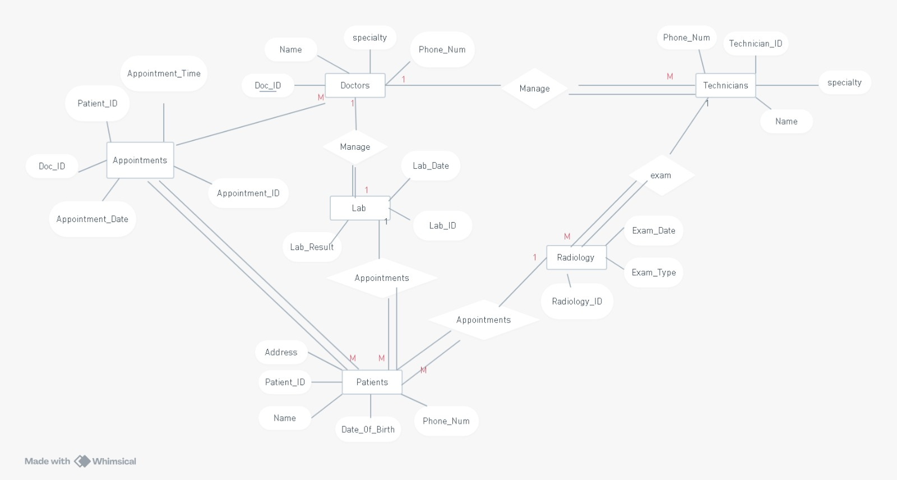

# Hospital Management System

A team graduation project completed as part of the **Digital Egypt Pioneers Initiative (DEPI) — .NET Web Developer track**. The repository contains an ASP.NET Core web application, database assets, an entity relationship diagram (ERD), project documentation, and a presentation.

## System Data Model

The ERD below is included in the repository and provides a visual introduction to the database design.

  

## Technology Stack

- ASP.NET Core on **.NET 8**
- C#
- Entity Framework Core 8
- SQL Server provider for Entity Framework Core
- ASP.NET Core Identity Entity Framework integration
- SendGrid and Twilio package references

The package list above is based on the repository project file. It identifies dependencies, not proof that every integration is fully configured or active.

## Project Structure

The web application project is organized into the following areas:

| Folder / File | Purpose indicated by project structure |
|---|---|
| Controllers | MVC request handling |
| Models | Application data models |
| Views | MVC presentation layer |
| ViewModel | View-specific data structures |
| Service | Service-layer code |
| Repositry | Repository-related code (folder name as currently present in the repository) |
| MiddleWares | Middleware components |
| Migrations | Entity Framework migration files |
| Program.cs | Application startup and service configuration |
| .csproj | .NET target framework and package references |

## Project Documentation

- [Database SQL script](https://github.com/EMAD7461/Hospital-Managment-System/blob/master/DATABASE%20Hospital%20STAFF.sql)
- [Project documentation — DOCX](https://github.com/EMAD7461/Hospital-Managment-System/blob/master/Hospital%20Management%20System%20Documentation%20Version%201.docx)
- [Project presentation — PPTX](https://github.com/EMAD7461/Hospital-Managment-System/blob/master/Hospital-Management-System%20Presentation%20version%201.pptx)
- [Teamwork document](https://github.com/EMAD7461/Hospital-Managment-System/blob/master/TeamWork.docx)

## Getting Started

1. Clone the repository.
2. Open `Hospital Managment System.sln` in Visual Studio 2022 or a compatible .NET 8 development environment.
3. Review the application configuration in `appsettings.json`.
4. Configure your own local SQL Server connection string and any required service credentials.
5. Restore NuGet packages and review the EF Core migrations before running the application.

**Security note:** Never publish production passwords, API keys, email credentials, or private connection strings in `appsettings.json`. Use local user secrets or environment variables for sensitive configuration.

## Author

**Mohamed Emad**  
DEPI — .NET Web Developer Track  
[GitHub](https://github.com/EMAD7461) · [LinkedIn](https://www.linkedin.com/in/mohmedemad/)

---

This README documents the repository structure and dependencies. For detailed functional requirements and implemented modules, consult the project documentation and source code.
